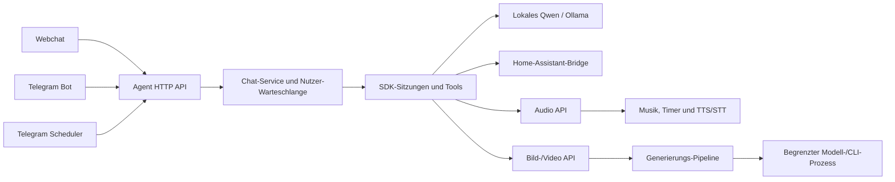

# Ribo – Architektur und Entwicklung

## Zuständigkeiten



### Agent

- `pi-agent/server.js`: Prozessstart, HTTP-Listener und geordneter Shutdown.
- `pi-agent/config.js`: validierte Konfiguration; keine verteilten Provider-Defaults im HTTP-Code.
- `pi-agent/app.js`: App-Factory, Authentifizierung, Nutzerkontext, gemeinsame Fehlergrenze.
  Ein Import startet keinen Server und lädt kein Modell.
- `pi-agent/http/`: Eingabevalidierung, Dateien, Chat-Endpunkte und SSE-/JSON-Formatierung.
- `pi-agent/services/chat.js`: Ablauf einer Nachricht und Abbruch, unabhängig von Express.
- `pi-agent/services/request-queue.js`: begrenzte FIFO-Warteschlange pro Nutzer.
- `pi-agent/services/sessions.js`: Besitz und Lebensdauer der SDK-Sitzungen, Modell-/Tool-Konfiguration.
- `pi-agent/services/response.js`: übersetzt SDK-Ereignisse in strukturierte Chat-Ereignisse.
- `pi-agent/services/prompt-context.js`: eigener, lesender Aufbau von Gedächtnis und Kommunikationsstil.
- `pi-agent/tools/index.js`: explizites Register der 24 Core-Tools mit Prüfung auf doppelte Namen.
- `pi-agent/tools/`, `pi-agent/plugins/`: Fachfunktionen mit eigenen Berechtigungsprüfungen.
- `pi-agent/lib/`: gemeinsame Hilfen für die Agent-Seite, nicht für Prozessstart oder HTTP-Routing.

Sitzungen bleiben wie bisher im Arbeitsspeicher. Neustarts verwerfen den Gesprächsverlauf;
Langzeitgedächtnis und Nutzerdaten bleiben in Dateien. Dauerhafte Chatprotokolle benötigen
zusätzliche Entscheidungen zu Speicherung und Aufbewahrung und sind kein stiller Nebeneffekt
dieser Strukturänderung.

### Telegram

- `start.js`: setzt die Bausteine zusammen, startet den Bot und beendet Hintergrundaufgaben.
- `config.js`, `users.js`: Konfiguration und lesender Zugriff auf Nutzerzuordnungen.
- `client.js`: ausschließlich HTTP-Transport zu Agent, Audio und Telegram-Datei-Download.
  Zeitlimits gelten auch beim Lesen des Antwortkörpers; Downloads sind größenbegrenzt.
- `messenger.js`: ausschließlich Text, Anhänge und optionale Sprachantworten auf Telegram.
- `handlers.js`: entscheidet anhand eingehender Nachrichten über Befehle, Bilder, Sprache und Text.
- `inbox.js`: eigene Fotoablage mit sicheren Nutzerpfaden und kollisionsfreien Dateinamen.
- `scheduler.js`, `background.js`: Zeitplan und Schutz vor Überlappung.
- `jobs/reminders.js`, `jobs/proactive.js`: getrennte Zustandsübergänge für Erinnerungen und proaktive Aufträge/Gewohnheiten.

Der Messenger prüft Datei-Marker gegen den Empfänger, bevor er den internen Datei-Endpunkt
aufruft. Ein Modelltext kann deshalb nicht beliebig Dateien eines anderen Nutzers als Anhang
anfordern. Lange Antworten werden als eine korrekt benannte Textdatei übertragen. Geplante
Aufträge behalten den zuvor eingeführten gemeinsamen Versandweg ohne zusätzliche Zusammenfassung.

### Native Dienste

`hey-ribo.py` bleibt der kompatible Startpunkt. `ribo_audio.py` enthält die Audio-HTTP-Schnittstelle
und TTS/STT-Anbindung. Reine Fachbausteine liegen unter `ribo_services/audio/`:

- `stations.py`: Senderkatalog.
- `music.py`: Player und Lautstärkeabsenkung; importiert kein TTS-Modell.
- `timers.py`: Timerzustand und Alarmwiedergabe.

Musik- und Timerlogik lässt sich dadurch ohne Mikrofon, TTS-Modell oder laufenden HTTP-Server
testen. Musikprozesse nutzen eine eigene Prozessgruppe ohne `preexec_fn`; der Elternprozess
behält keine offenen MPV-Logdatei-Handles.

Beim Bilddienst bleiben die vorhandenen Startpfade erhalten:

- `imagegen-service/server.py`: authentifizierte HTTP-Schnittstelle.
- `service_config.py`: unveränderliches, typisiertes Konfigurationsobjekt.
- `engines.py`: reine Engine-Metadaten und Aliase.
- `pipeline.py`: Bild-/Video-Generierung und Besitz des Modell-Workers.
- `jobs.py`: begrenzte Prozessausführung und auftragsbezogene Abbruchsignale.
- `worker_client.py`, `model_worker.py`: Kommunikation und Wiederverwendung des Flux2-Modells.

## Gemeinsame Verträge

`shared/` ist die gemeinsame Quelle für atomare Dateizugriffe, kurze Dateisperren, Identitäten,
Erinnerungszeiten, Zustellstatus und öffentliche Fehler. Beide eigenen Node-Images erhalten
dieselben Dateien. Es gibt keine zweite Kopie der Speicherlogik im Telegram-Dienst.

- HTTP kennt Fachabläufe über injizierte Services; der Chat-Service importiert Express nicht.
- Telegram-Handler erhalten Transport und Messenger als Abhängigkeiten. Tests brauchen keinen Bot-Token.
- Konfigurationsfehler werden beim Start erkannt; Zugangsdaten werden nicht als Konfigurationsobjekt geloggt.
- Erwartete HTTP-Fehler haben Status und Code. Unbekannte interne Fehler werden nicht ungefiltert an Clients gegeben.
- Antworten erhalten eine Request-ID. Neue Prozessmeldungen verwenden strukturierte Ereignisse.
- Nutzer- und Tool-Kontext bleibt über asynchrone Aufrufe isoliert; geplante Zustellung hat einen eigenen Ausgang.
- Abbruch, Reset, Queue-Limits und Shutdown werden an einer Stelle koordiniert.
- Plugins bleiben geprüfter Code mit Admin-Freigabe, kein eigener isolierter Prozess.

## Prüfen und weiterentwickeln

```bash
make check    # Python-/JS-/Shell-Syntax und Manifeste; benötigt vorhandenes Agent-Image
make verify   # Images bauen, Syntax prüfen, sämtliche Offline-Regressionstests ausführen
```

`make verify` startet Node-Tests ausschließlich in wegwerfbaren Containern mit tmpfs-Workspace
und ohne Netzwerk. Python-Tests verwenden künstliche Daten und simulierte Audio-/Modellbausteine.
Der produktive Workspace wird nicht in diese Testcontainer eingebunden.

Die GitHub-Konfiguration unter `.github/workflows/ci.yml` führt denselben Ablauf bei Push,
Pull Request oder manueller Ausführung aus. Sie verwendet ausschließlich synthetische
Dienstkonfiguration, ein fest gepinntes Checkout-Action-Commit und lesende Repository-Rechte.
Die Konfiguration ist lokal vorbereitet; ein entfernter CI-Lauf ist erst nach einem Push möglich.

Der optionale echte Modelltest bleibt separat: Er benötigt lokalen Ollama-Zugriff und einen
wegwerfbaren Workspace. Native GPU-Tests gehören ebenfalls zur lokalen Integrationsprüfung.

Für neue Funktionen: Fachlogik in den zuständigen Service/das Tool, Transportänderungen in den
Adapter. Ein neuer Fehlerfall bekommt einen Verhaltenstest. Verträge oder Datenformate werden
gezielt migriert; bestehende Nutzerdaten werden nicht beiläufig neu geschrieben. Abhängigkeiten
werden bewusst und mit Lockfile geändert.

## Grenzen des Umbaus

Die eigene Anwendungsstruktur wurde überarbeitet und ihre Verträge getestet. Das ist keine
Garantie für Fehlerfreiheit sämtlicher Funktionen und Anbieter. Vendorte Ollama-Erweiterung,
Govee-/MQTT-Software und Modelldateien sind eigenständige Komponenten. Gemeinsame JSON-Sperren
setzen kurze synchrone Änderungen auf einem lokalen Dateisystem voraus; für verteilten Betrieb
oder deutlich größere Datenmengen wäre ein anderer Speichervertrag nötig.

## Verifizierter Stand dieses Umbaus

Lokal bestanden: 66 Agent-Tests, 25 Telegram-Tests und 22 Python-Tests, insgesamt **113**.
Zusätzlich wurden das echte lokale Qwen-Modell (Text, abgefangener geplanter Plugin-Versand,
Bildanalyse und SSE), TTS/STT sowie GPU-Generierung und Abbruch geprüft. Die Container-
Gesundheitsprüfung verwendet die explizite IPv4-Loopback-Adresse passend zum Listener.
Die GitHub-CI ist vorbereitet; sie wurde nicht durch einen Push ausgelöst.

Leistungsprüfung vom 9. November: `services/tool-execution.js` kapselt Rechtekontext, Ergebnisbegrenzung und optionales Gewohnheitenprotokoll (`lib/interactions.js`). Zeitfelder und Vergleichsmessungen sind in PERFORMANCE-RESULTS.md beschrieben.

Das Nutzergedächtnis wird durch `lib/memory-store.js` verwaltet (festes Grundwissen plus gezielte Suche). `services/prompt-context.js` projiziert aktuelle Fakten pro Anfrage; `installContextBudget` begrenzt die ausgehende SDK-Anfrage nach deren Projektion. Einzelheiten und Grenzen: PERFORMANCE-ROUND2.md.

Die dritte Leistungsrunde ergänzt `services/model-requests.js` für Modellwarteschlange/Antwortlimit und `pi-telegram/preferences.js`, `trace.js`, `stream.js`, `preview.js` für persistente Ausgabeeinstellungen, Zeitmessung und temporäre Entwürfe. Hintergrundpriorität und Grenzen sind in PERFORMANCE-ROUND3.md dokumentiert.

`lib/uploads.js`, `http/upload-routes.js` und das `uploads`-Tool verwalten eigene Bilddateien. Die aktuelle Bildquelle ist an den Anfragekontext gebunden; Web und Telegram verwenden dieselbe Ablage. Einzelheiten: IMAGE-UPLOADS.md.

`services/model-catalog.js` und `model-selection.js` ergänzen die laufende Modellwahl pro Nutzer. Der SDK-Wechsel erhält die Sitzung; Chat und Modellauswahl teilen eine Nutzerwarteschlange. Endpunkte und Grenzen: MODEL-SWITCHING.md.
